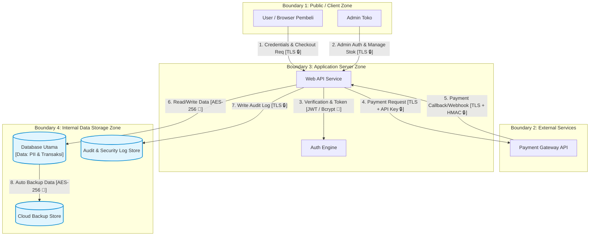

# Threat Modeling & Analisis Risiko - Toko Online

## 1. Inventaris Aset & Klasifikasi CIA
| Kategori Aset | Nama Aset | Kerahasiaan (C) | Integritas (I) | Ketersediaan (A) | Alasan Klasifikasi |
|---|---|---|---|---|---|
| **Data** | Data Transaksi & Pembayaran | Tinggi | Tinggi | Sedang | Mencegah manipulasi status transaksi dan kebocoran riwayat pembelian. |
| **Data** | Data Pribadi Pengguna (PII) | Tinggi | Sedang | Sedang | Melindungi alamat, nomor HP, dan email pengguna. |
| **Layanan** | API Web E-Commerce & Checkout | Sedang | Tinggi | Tinggi | Downtime pada checkout langsung menghentikan pendapatan toko. |
| **Secrets** | API Key Payment Gateway & TLS Key | Sangat Tinggi | Sangat Tinggi | Sedang | Kebocoran key memicu manipulasi saldo dan pemalsuan transaksi. |
| **Backup** | Backup Database Transaksi | Tinggi | Tinggi | Sedang | Sumber pemulihan data utama saat terjadi kebocoran atau insiden sistem. |
| **Log** | Audit & Security Log | Sedang | Sangat Tinggi | Sedang | Harus utuh untuk jejak investigasi forensik jika terjadi peretasan. |
| **Akun** | Kredensial Akun Admin & Pembeli | Tinggi | Tinggi | Sedang | Mencegah account takeover dan penyalahgunaan wewenang admin. |

---

## 2. Diagram DFD & Trust Boundary

---

## 3. Identifikasi 10 Ancaman STRIDE

- Spoofing (Client -> API): Peretas mencuri token session JWT via XSS untuk menyamar sebagai pembeli lain. (Aset Terdampak: Akun Pembeli)

- Spoofing (Admin Portal): Brute force login admin karena belum ada fitur MFA. (Aset Terdampak: Akses Sistem Admin)

- Tampering (Pembeli -> API): Pembeli merubah parameter harga produk (price) pada HTTP request checkout. (Aset Terdampak: Data Transaksi)

* Tampering (API -> Database): Serangan SQL Injection pada kolom pencarian produk untuk merusak data stok. (Aset Terdampak: Database Produk)

* Repudiation (Webhook PG -> API): Pelaku memalsukan request webhook pembayaran tanpa log signature yang bisa dibuktikan. (Aset Terdampak: Log Audit)

* Information Disclosure (Client -> API): Intersepsi data pribadi pembeli akibat traffic HTTP unencrypted. (Aset Terdampak: Data PII)

* Information Disclosure (Backup Store): File backup database di cloud storage bocor karena akses diset publik. (Aset Terdampak: Seluruh Data Toko)

* Denial of Service (API Server): HTTP Flood request pada endpoint pencarian produk yang membuat server crash. (Aset Terdampak: Layanan Web API)

* Denial of Service (Database): Transaksi berlebih secara bersamaan menghabiskan pool koneksi database. (Aset Terdampak: Database Utama)

* Elevation of Privilege (API User Profile): Eksploitasi IDOR pada URL /api/user/{id} untuk mengganti role user biasa menjadi admin. (Aset Terdampak: Hak Akses Sistem)

## 4. Analisis 5 Risiko Prioritas

### Manipulasi Harga Checkout (Tampering)

Kemungkinan: Tinggi | Dampak: Tinggi | Tingkat Risiko: KRITIS

Justifikasi: Sangat mudah diubah dari sisi browser/client jika tidak di-check ulang oleh server, berdampak kerugian finansial langsung.

### SQL Injection Database (Tampering)

Kemungkinan: Sedang | Dampak: Sangat Tinggi | Tingkat Risiko: KRITIS

Justifikasi: Berisiko menghapus seluruh database toko atau mencuri data sensitif pelanggan.

### Celah IDOR Hak Akses (Elevation of Privilege)

Kemungkinan: Tinggi | Dampak: Tinggi | Tingkat Risiko: TINGGI

Justifikasi: Pengguna biasa bisa mengubah parameter ID pada URL untuk mengambil alih hak akses akun admin.

### Kebocoran Storage Backup (Information Disclosure)

Kemungkinan: Sedang | Dampak: Tinggi | Tingkat Risiko: TINGGI

Justifikasi: Kelalaian konfigurasi cloud storage membuat seluruh data PII dan riwayat pembayaran bocor ke publik.

### DoS pada Endpoint Checkout (Denial of Service)

Kemungkinan: Tinggi | Dampak: Sedang | Tingkat Risiko: TINGGI

Justifikasi: Tumbangnya server saat event promo mengakibatkan pembeli tidak bisa bertransaksi.

## 5. Rencana Kontrol & Mitigasi Keamanan

* Mitigasi Manipulasi Harga: Server selalu melakukan query ulang (re-fetch) harga resmi barang dari database berdasarkan product_id, mengabaikan harga dari input client.

* Mitigasi SQL Injection: Menggunakan Prepared Statements / Parameterized Queries via ORM (Prisma/TypeORM) pada semua query ke database.

* Mitigasi IDOR: Terapkan Role-Based Access Control (RBAC) dan validasi identitas user langsung dari token JWT server, bukan dari parameter URL.

* Mitigasi Kebocoran Backup: Aktifkan enkripsi at-rest AES-256 pada bucket penyimpan backup dan matikan opsi Public Access.

* Mitigasi DoS: Terapkan Rate Limiting (maksimal 100 request/menit per IP) serta integrasikan Cloudflare WAF.
